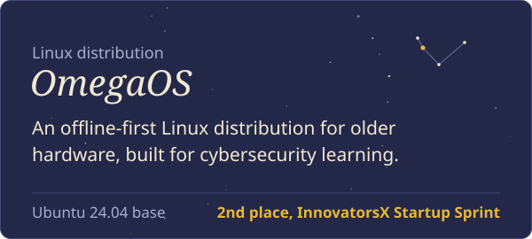
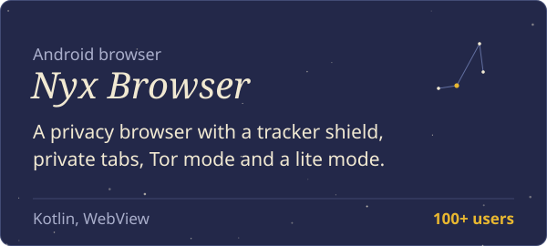
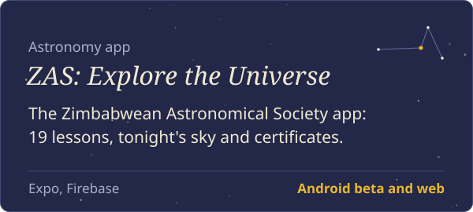
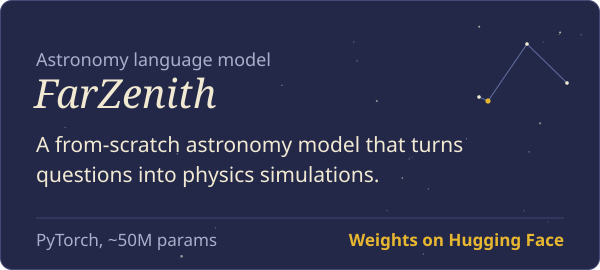
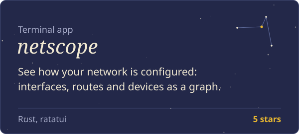

I'm a software engineer at the Zimbabwean Astronomical Society, a student at the National University of Science and Technology (NUST), and a Linux instructor with Cisco Networking Academy. I also do AI research with Algoverse.

Most of what I build sits close to the operating system: a Linux distribution, a privacy browser, terminal tools in Rust, and research on what language models can learn about people who think they are anonymous.

  <picture>
    <source media="(prefers-color-scheme: dark)" srcset="https://streak-stats.demolab.com/?user=Kolgrim33&theme=dark&background=0D1117&border=30363D&stroke=30363D&ring=E8B730&fire=E8B730&currStreakNum=F1E9D2&sideNums=F1E9D2&currStreakLabel=E8B730&sideLabels=A9AECB&dates=7C8CC4" />
    <source media="(prefers-color-scheme: light)" srcset="https://streak-stats.demolab.com/?user=Kolgrim33&theme=default&background=FFFFFF&border=E1E4E8&stroke=E1E4E8&ring=D97706&fire=D97706&currStreakNum=1F2937&sideNums=1F2937&currStreakLabel=D97706&sideLabels=4B5563&dates=6B7280" />
    
  </picture>

## Upstream

Code I've sent to projects other people maintain.

| Project | Contribution | Status |
|---|---|---|
| [rust-lang/rust](https://github.com/rust-lang/rust/pull/165518) | Style guide: remove the rule that `extern` items must spell out their ABI, following a Style Team decision | Merged |
| [Linux kernel](https://lore.kernel.org/all/20261025190322.449324-1-mashikiselby@gmail.com/) | Fix a device-tree reference leak in `tegra186_mc_probe_device()`, NVIDIA Tegra memory-controller driver | Accepted by maintainer Krzysztof Kozlowski into the memory-controller tree |
| [rust-lang/rust](https://github.com/rust-lang/rust/pull/165619) | Boolean expressions in `is_*_feature_detected!`, and [`RangeIntersect`](https://github.com/rust-lang/rust/pull/165618) for `core::range` types | In review |
| [deepseek-ai/DeepSeek-V3](https://github.com/deepseek-ai/DeepSeek-V3/pull/1596) | `deepseek-setup`, a Rust CLI that checks hardware and sets up inference, plus a [requirements checker](https://github.com/deepseek-ai/DeepSeek-V3/pull/1584) | In review |
| [archlinux/archinstall](https://github.com/archlinux/archinstall/pulls?q=author%3AKolgrim33) | Five installer fixes: swap, LVM with Btrfs, custom profiles, device paths, wiping | In review |
| [sxyazi/yazi](https://github.com/sxyazi/yazi/pull/4482) | Copy and move files out of the trash | In review |

## Projects

<table>
  <tr>
    <td width="50%"></td>
    <td width="50%"></td>
  </tr>
  <tr>
    <td width="50%"></td>
    <td width="50%"></td>
  </tr>
  <tr>
    <td width="50%"></td>
    <td width="50%"></td>
  </tr>
</table>

Source: [OmegaOS](https://github.com/Kolgrim33/OmegaOS), [Nyx Browser](https://github.com/Kolgrim33/Nyx-Browser-), [Tor paper code and data](https://github.com/Kolgrim33/tor-words-paper), [netscope](https://github.com/Kolgrim33/netscope).

### More

**Rust**
- [omega-lang](https://github.com/Kolgrim33/omega-lang), a small language for security scripting
- [linux_replay](https://github.com/Kolgrim33/linux_replay), a timeline of your Linux setup from system logs and package history
- [rulesmith](https://github.com/Kolgrim33/rulesmith), build firewall rules with the arrow keys instead of typing them

**Arch Linux and Hyprland**
- [hyprkit](https://github.com/Kolgrim33/hyprkit), a Hyprland toolkit with a Waybar module manager, a doctor and a config linter
- [centium](https://github.com/Kolgrim33/centium), a friendlier wrapper around Arch package management
- [pkgstory](https://github.com/Kolgrim33/pkgstory), your Arch install's history, told from `pacman.log`
- [arch-doctor](https://github.com/Kolgrim33/arch-doctor), health checks for a rolling-release system

**Security and AI**
- [HADES web watcher](https://github.com/Kolgrim33/HADES--WEB-WATCHER), find where a username appears across the web
- [R3KON](https://github.com/Kolgrim33/r3kon), an offline AI assistant for cybersecurity training
- [deepseek-cyber-eval](https://github.com/Kolgrim33/deepseek-cyber-eval), a cybersecurity evaluation suite for DeepSeek models
- [Centium VPN](https://github.com/Kolgrim33/centiumvpn), a Tor-based VPN

**Apps**
- [MyCharacter AI](https://mycharacterai.web.app), chat with original characters, including African storytellers from twelve countries
- [Aethar Tech](https://aethar-tech.web.app), the studio behind Nyx Browser

## Experience

- **Software Engineer**, Zimbabwean Astronomical Society, Oct 2026 to now
- **Rust contributor**, rust-lang/rust, Aug 2026 to now
- **Linux Instructor**, Cisco Networking Academy, Jun 2026 to now
- **AI Research**, Algoverse
- **Student**, National University of Science and Technology

## Tools I use

| | |
|---|---|
| Languages | Rust, C, C++, Python, TypeScript, Kotlin |
| Systems | Linux, Arch, Ubuntu, Hyprland, Docker |
| ML | PyTorch, Hugging Face |
| Apps | Expo, React, Firebase, Android |

## Elsewhere

[LinkedIn](https://www.linkedin.com/in/selby-mashiki-974a58229/) &nbsp; [Devpost](https://devpost.com/mashikiselby) &nbsp; [Hugging Face](https://huggingface.co/Kolgrim) &nbsp; [Research on Zenodo](https://doi.org/10.5281/zenodo.23453955)
